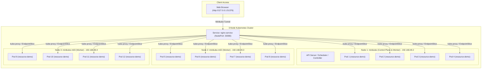
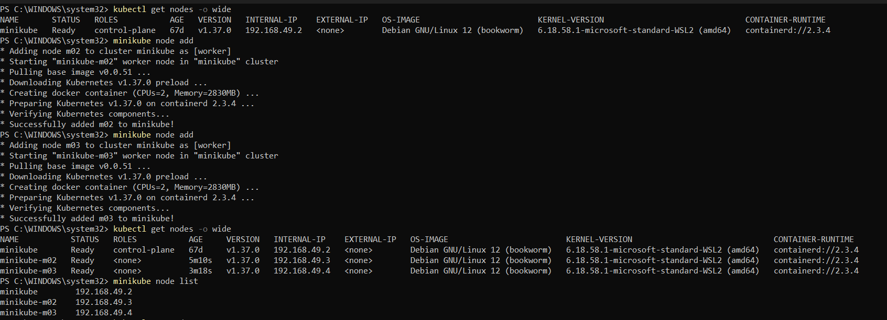
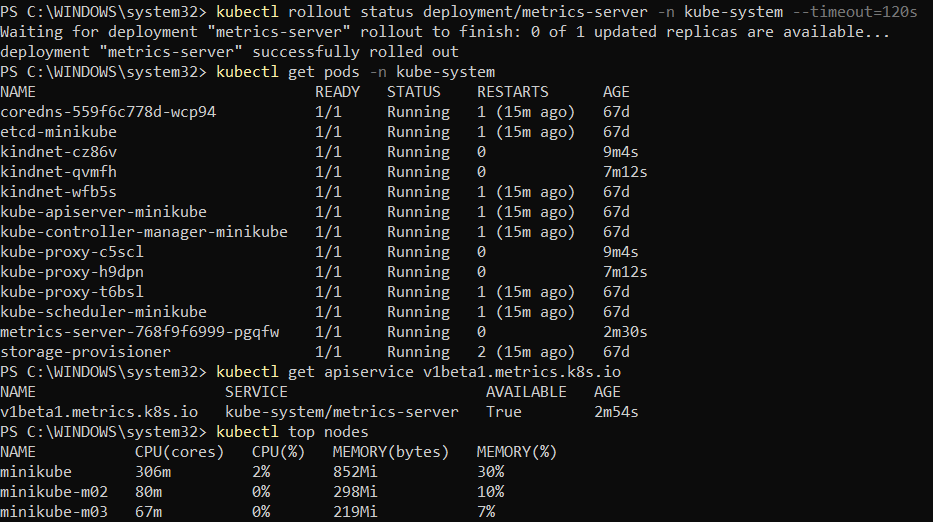
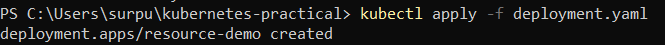
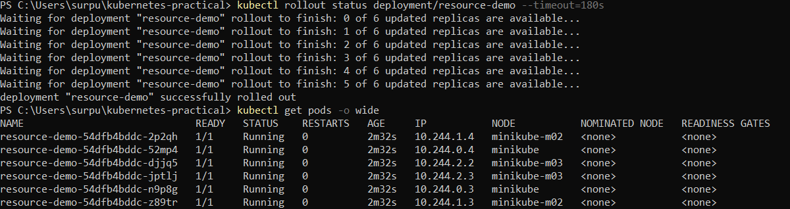
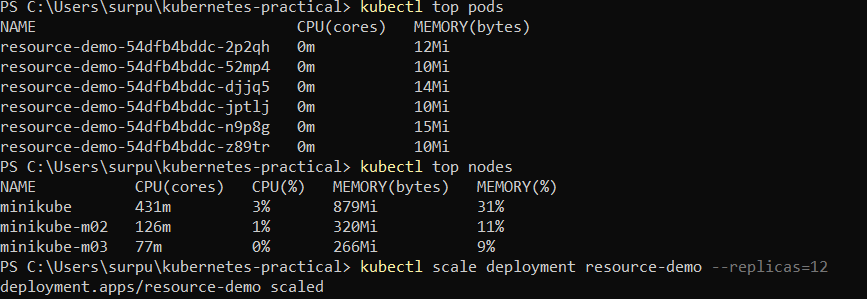
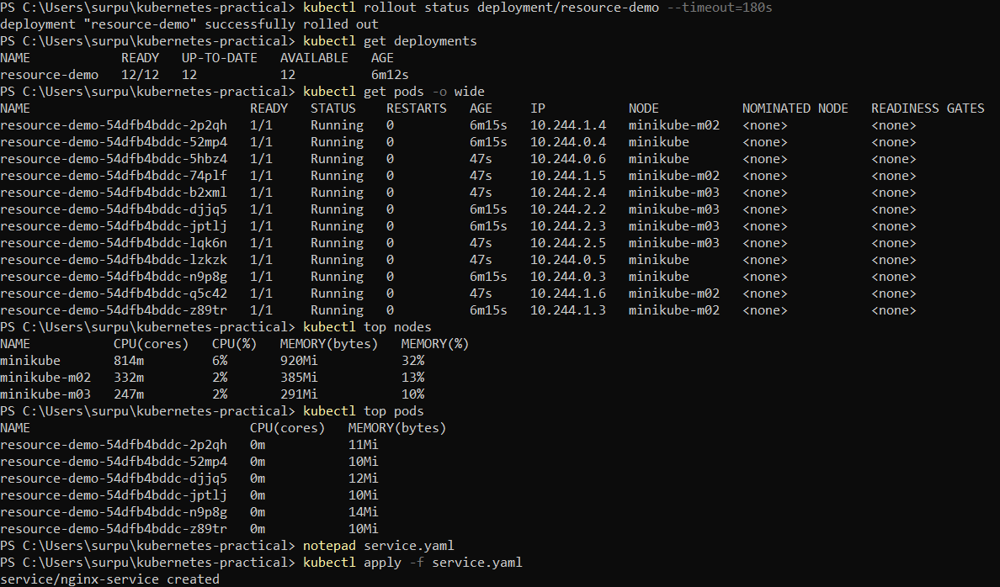
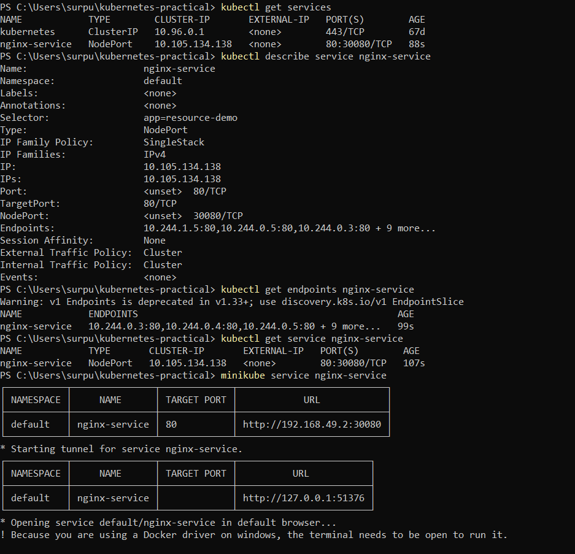
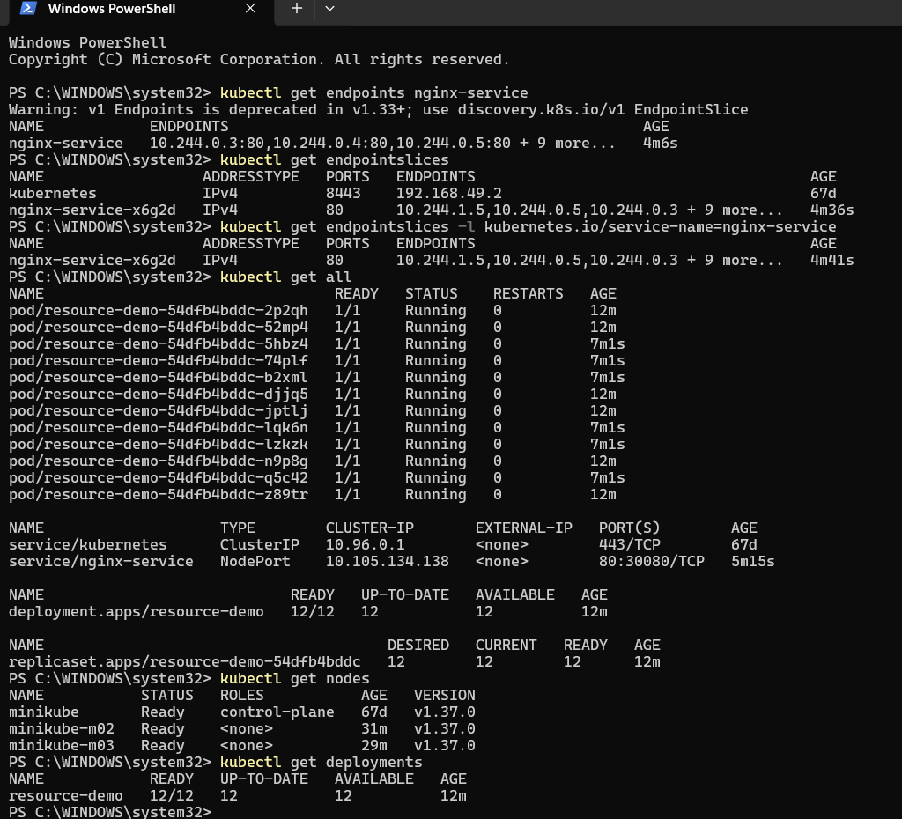
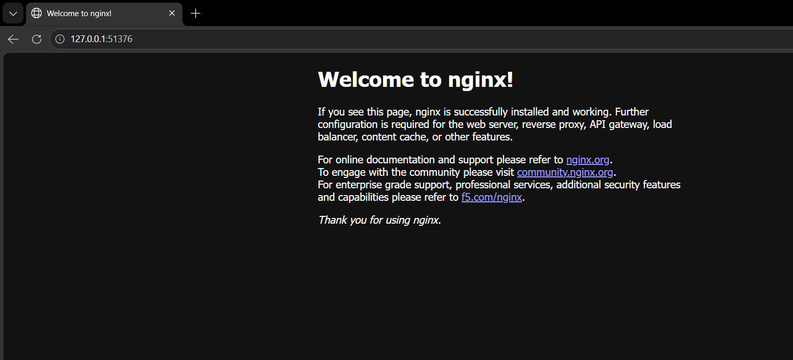

# Kubernetes Practical Experiment: Resource Allocation, Scheduling & Load Balancing in a Three-Node Cluster

[](https://kubernetes.io/)
[](https://minikube.sigs.k8s.io/)
[](https://containerd.io/)
[](https://nginx.org/)
[](https://microsoft.com/PowerShell)

> **Reference Document:** Based on the official laboratory guide [Kubernetes Practical Experiment: Analyze Resource Allocation, Scheduling, and Load Balancing in a Three-Node Cluster](docs/kubernetes_practical_experiment.pdf).

---

## 📑 Table of Contents
1. [Aim](#-aim)
2. [Requirements & Prerequisites](#-requirements--prerequisites)
3. [Cluster Architecture](#-cluster-architecture)
4. [Repository Structure](#-repository-structure)
5. [Step-by-Step Procedure & Execution](#-step-by-step-procedure--execution)
   - [Step 1: Verify the Kubernetes Cluster](#step-1-verify-the-kubernetes-cluster)
   - [Step 2: Analyze Available Resources & Metrics Server](#step-2-analyze-available-resources--metrics-server)
   - [Step 3: Create a Deployment with Requests & Limits](#step-3-create-a-deployment-with-requests--limits)
   - [Step 4: Analyze Pod Scheduling Across Nodes](#step-4-analyze-pod-scheduling-across-nodes)
   - [Step 5: Analyze Resource Allocation](#step-5-analyze-resource-allocation)
   - [Step 6: Test Pod Distribution with 12 Replicas](#step-6-test-pod-distribution-with-more-replicas)
   - [Step 7: Create a Kubernetes Service for Load Balancing](#step-7-create-a-kubernetes-service-for-load-balancing)
   - [Step 8: Verify Load-Balancing Endpoints & EndpointSlices](#step-8-verify-load-balancing-endpoints)
   - [Step 9: Test Application Access via Browser](#step-9-test-the-application)
   - [Step 10: Observe Resource Utilization After Scaling](#step-10-observe-resource-utilization-again)
   - [Step 11: Clean Up Resources](#step-11-clean-up-resources)
6. [Observation Table](#-observation-table)
7. [In-Depth Technical Insights](#-in-depth-technical-insights)
8. [Expected Learning Outcomes](#-expected-learning-outcomes)
9. [Result](#-result)
10. [Suggested Practical Extension](#-suggested-practical-extension)

---

## 🎯 Aim
To analyze **resource allocation**, **pod scheduling**, and **load balancing** in an existing three-node Kubernetes cluster by deploying containerized applications, configuring CPU and memory requests/limits, observing intelligent pod distribution by `kube-scheduler`, and verifying Service-based load balancing using `NodePort` and `EndpointSlices`.

---

## 🛠 Requirements & Prerequisites
- **Kubernetes Cluster**: 3-node cluster configured via Minikube (`minikube` control-plane, `minikube-m02` worker, `minikube-m03` worker).
- **Cluster Management Tool**: `kubectl` CLI configured and connected to the cluster.
- **Metrics Engine**: Kubernetes `metrics-server` installed and active in the `kube-system` namespace.
- **Network & Images**: Internet connectivity to pull public container images (`nginx:latest`).
- **Terminal**: Windows PowerShell.

---

## 🏗 Cluster Architecture



---

## 📁 Repository Structure

```text
.
├── docs/
│   └── kubernetes_practical_experiment.pdf      # Original experiment reference manual
├── manifests/
│   ├── deployment.yaml                         # Deployment spec (6/12 replicas, requests & limits)
│   └── service.yaml                            # NodePort Service spec (port 80:30080)
├── screenshots/
│   ├── 01-verify-cluster-nodes.png             # Step 1: Cluster & 3-node readiness check
│   ├── 02-metrics-server-and-top-nodes.png     # Step 2: Metrics-server check & initial top nodes
│   ├── 03-apply-deployment.png                 # Step 3: Deployment application
│   ├── 04-pod-scheduling-6-replicas.png        # Step 4: 6 replicas distribution across 3 nodes
│   ├── 05-resource-allocation-and-scale-to-12.png # Step 5: Pod/node top and scale command
│   ├── 06-twelve-replicas-distribution-and-service-create.png # Step 6: 12 replicas distribution & service apply
│   ├── 07-service-endpoints-and-tunnel.png     # Step 7 & 8: Service details & minikube tunnel
│   ├── 08-browser-verification-nginx.png       # Step 9: Browser verification of Nginx web app
│   └── 09-endpointslices-and-cluster-overview.png # Step 8: EndpointSlices & get all overview
├── scripts/
│   ├── deploy.ps1                              # Automated rollout script
│   └── cleanup.ps1                             # Automated resource cleanup script
├── .gitignore
└── README.md
```

---

## 🚀 Step-by-Step Procedure & Execution

### Step 1: Verify the Kubernetes Cluster
Ensure all three nodes in the cluster exist and report a `Ready` status. If working on a single-node minikube installation, secondary worker nodes are initialized using `minikube node add`.

```powershell
# Check nodes and detailed network properties
kubectl get nodes -o wide

# Add worker nodes if creating a multi-node cluster
minikube node add
minikube node add

# Verify nodes list and IP bindings
minikube node list
```

- **Observed Nodes**:
  - `minikube`: Control-plane, `Ready`, IP: `192.168.49.2`, OS: `Debian GNU/Linux 12 (bookworm)`, Runtime: `containerd://2.3.4`
  - `minikube-m02`: Worker node, `Ready`, IP: `192.168.49.3`
  - `minikube-m03`: Worker node, `Ready`, IP: `192.168.49.4`



---

### Step 2: Analyze Available Resources & Metrics Server
Metrics Server collects resource metrics from Kubelets and exposes them through the Metrics API (`metrics.k8s.io`).

```powershell
# Check Metrics Server rollout status
kubectl rollout status deployment/metrics-server -n kube-system --timeout=120s

# Verify pods in kube-system
kubectl get pods -n kube-system

# Verify Metrics API service registration
kubectl get apiservice v1beta1.metrics.k8s.io

# Inspect baseline resource consumption across nodes
kubectl top nodes
```

- **Observed Baseline Resource Utilization**:
  - `minikube`: CPU `306m` (2%), Memory `852Mi` (30%)
  - `minikube-m02`: CPU `80m` (0%), Memory `298Mi` (10%)
  - `minikube-m03`: CPU `67m` (0%), Memory `219Mi` (7%)



---

### Step 3: Create a Deployment with Requests & Limits
Create `manifests/deployment.yaml` with explicit container resource requests and limits to guide `kube-scheduler`:

```yaml
apiVersion: apps/v1
kind: Deployment
metadata:
  name: resource-demo
spec:
  replicas: 6
  selector:
    matchLabels:
      app: resource-demo
  template:
    metadata:
      labels:
        app: resource-demo
    spec:
      containers:
        - name: nginx
          image: nginx
          resources:
            requests:
              cpu: "100m"      # 0.1 CPU core guaranteed
              memory: "64Mi"   # 64 MiB RAM guaranteed
            limits:
              cpu: "200m"      # Maximum 0.2 CPU core cap
              memory: "128Mi"  # Maximum 128 MiB RAM cap before OOMKilled
```

Apply the deployment:
```powershell
kubectl apply -f manifests/deployment.yaml
```



---

### Step 4: Analyze Pod Scheduling Across Nodes
Observe how the `kube-scheduler` distributes the 6 pods across the 3 nodes based on allocatable capacity and filtering/scoring predicates:

```powershell
# Monitor deployment rollout
kubectl rollout status deployment/resource-demo --timeout=180s

# Inspect scheduled pods and node assignments
kubectl get pods -o wide
```

- **Scheduling Results for 6 Replicas**:
  - `minikube`: 2 pods (`resource-demo-...-52mp4`, `resource-demo-...-n9p8g`)
  - `minikube-m02`: 2 pods (`resource-demo-...-2p2qh`, `resource-demo-...-z89tr`)
  - `minikube-m03`: 2 pods (`resource-demo-...-djjq5`, `resource-demo-...-jptlj`)
  - **Distribution**: Exactly **2 pods per node (1:1:1 balanced ratio)**.



---

### Step 5: Analyze Resource Allocation
Inspect the resource usage of the deployed pods and the updated node utilization:

```powershell
# Check actual CPU and memory usage of each pod
kubectl top pods

# Check updated utilization on all cluster nodes
kubectl top nodes
```

- **Pod Resource Usage**: Each Nginx pod consumes ~`10Mi - 15Mi` memory and `< 1m` CPU at idle.
- **Node Consumption (with 6 pods running)**:
  - `minikube`: `431m` CPU (3%), `879Mi` RAM (31%)
  - `minikube-m02`: `126m` CPU (1%), `320Mi` RAM (11%)
  - `minikube-m03`: `77m` CPU (0%), `266Mi` RAM (9%)



---

### Step 6: Test Pod Distribution with More Replicas (Scaling to 12)
Scale the deployment from 6 to 12 replicas to verify whether the scheduler maintains balanced resource distribution:

```powershell
# Scale deployment to 12 replicas
kubectl scale deployment resource-demo --replicas=12

# Wait for completion and verify pod distribution
kubectl rollout status deployment/resource-demo --timeout=180s
kubectl get deployments
kubectl get pods -o wide
```

- **Scheduling Results for 12 Replicas**:
  - `minikube`: 4 pods (`52mp4`, `5hbz4`, `lzkzk`, `n9p8g`)
  - `minikube-m02`: 4 pods (`2p2qh`, `74plf`, `q5c42`, `z89tr`)
  - `minikube-m03`: 4 pods (`b2xml`, `djjq5`, `jptlj`, `lqk6n`)
  - **Distribution**: Perfectly balanced with **4 pods per node**.



---

### Step 7: Create a Kubernetes Service for Load Balancing
Create `manifests/service.yaml` to expose the pods via a `NodePort` service:

```yaml
apiVersion: v1
kind: Service
metadata:
  name: nginx-service
spec:
  type: NodePort
  selector:
    app: resource-demo
  ports:
    - port: 80
      targetPort: 80
      nodePort: 30080
```

Apply the service configuration:
```powershell
kubectl apply -f manifests/service.yaml
```

---

### Step 8: Verify Load-Balancing Endpoints
Verify that the Service has automatically discovered all 12 backend pods through labels and registered them as healthy endpoints:

```powershell
# Check registered Service
kubectl get services

# Inspect Service details and target endpoints
kubectl describe service nginx-service

# Verify Endpoints and EndpointSlices
kubectl get endpoints nginx-service
kubectl get endpointslices -l kubernetes.io/service-name=nginx-service

# Start Minikube service tunnel (for Docker/WSL driver access on Windows)
minikube service nginx-service
```

- **NodePort Assigned**: `30080/TCP`
- **Backend Endpoints**: All 12 pod IPs (e.g. `10.244.0.3:80`, `10.244.0.4:80`, `10.244.1.5:80`, ...) registered.
- **Tunnel URL**: Forwarded to `http://127.0.0.1:51376`.





---

### Step 9: Test the Application in Browser
Navigate to the exposed service URL in the web browser:
- Direct NodePort: `http://<NODE-IP>:30080`
- Minikube Tunnel on Windows: `http://127.0.0.1:51376`

The browser confirms successful connection to the Nginx backend:



---

### Step 10: Observe Resource Utilization After Scaling
Compare the cluster resource usage with 12 active pods against the initial baseline:

```powershell
kubectl top nodes
kubectl top pods
```

- **Node Utilization (Post-Scaling, 12 pods)**:
  - `minikube`: `814m` CPU (6%), `920Mi` RAM (32%)
  - `minikube-m02`: `332m` CPU (2%), `385Mi` RAM (13%)
  - `minikube-m03`: `247m` CPU (2%), `291Mi` RAM (10%)

---

### Step 11: Clean Up Resources
Tear down the deployed resources to return the cluster to its pristine state:

```powershell
kubectl delete service nginx-service
kubectl delete deployment resource-demo
```

Or execute the provided cleanup script:
```powershell
.\scripts\cleanup.ps1
```

---

## 📊 Observation Table

| Experiment Stage | Observation to Record | Recorded Value / Output |
| :--- | :--- | :--- |
| **Cluster Verification** | Status of all three nodes | `minikube` (Ready, Control-plane)<br>`minikube-m02` (Ready, Worker)<br>`minikube-m03` (Ready, Worker) |
| **Initial Resource Utilization** | CPU and memory usage of each node (Baseline) | • `minikube`: 306m (2%), 852Mi (30%)<br>• `minikube-m02`: 80m (0%), 298Mi (10%)<br>• `minikube-m03`: 67m (0%), 219Mi (7%) |
| **Six Replicas Distribution** | Number of pods scheduled on each node | • `minikube`: 2 pods<br>• `minikube-m02`: 2 pods<br>• `minikube-m03`: 2 pods<br>*(Total = 6 pods, Equal 1:1:1 distribution)* |
| **Twelve Replicas Distribution** | Updated pod distribution across nodes | • `minikube`: 4 pods<br>• `minikube-m02`: 4 pods<br>• `minikube-m03`: 4 pods<br>*(Total = 12 pods, Equal 4:4:4 distribution)* |
| **Resource Allocation** | CPU and memory requests and limits per container | • **Requests**: CPU `100m` (0.1 core), RAM `64Mi`<br>• **Limits**: CPU `200m` (0.2 core), RAM `128Mi`<br>• **QoS Class**: `Burstable` |
| **Load Balancing** | Service backend endpoints and application response | • **Service Type**: `NodePort` (Port 80 -> NodePort 30080)<br>• **Endpoints**: All 12 pod IPs active<br>• **Response**: HTTP 200 OK (`Welcome to nginx!`) |
| **Final Utilization** | CPU and memory usage after scaling to 12 replicas | • `minikube`: 814m (6%), 920Mi (32%)<br>• `minikube-m02`: 332m (2%), 385Mi (13%)<br>• `minikube-m03`: 247m (2%), 291Mi (10%) |

---

## 🔬 In-Depth Technical Insights

### 1. How the Kubernetes Scheduler Decides Node Placement
The `kube-scheduler` operates via a two-phase process:
1. **Filtering (Predicates)**: Filters out nodes that do not satisfy the pod's requirements (e.g., insufficient unreserved allocatable CPU/memory requests, taints/tolerations, node selectors).
2. **Scoring (Priorities)**: Scores remaining eligible nodes. Algorithms like `NodeResourcesFit` (specifically `LeastAllocatedPriority` and `BalancedResourceAllocation`) favor nodes with lower allocated resource ratios. This is why the 6 pods resulted in exactly 2-2-2 and 12 pods resulted in 4-4-4.

### 2. Requests vs. Limits
- **Requests**: Used exclusively by `kube-scheduler` for placement decisions. Guaranteed to the container.
- **Limits**: Enforced at runtime by the container runtime via Linux `cgroups` (CPU throttling for CPU limits, `OOMKilled` eviction for exceeding memory limits).
- Because requests (`100m`, `64Mi`) differ from limits (`200m`, `128Mi`), the pod receives the **Burstable** Quality of Service (QoS) class.

### 3. Service Load Balancing & EndpointSlices
- `nginx-service` does not proxy traffic through a single process; rather, `kube-proxy` configures Linux kernel packet forwarding rules (`iptables` / `IPVS`) or eBPF.
- Kubernetes `EndpointSlices` provide scalable tracking of backend endpoints. Connections arriving on port `30080` are distributed across all 12 pod endpoints in a randomized round-robin fashion.

---

## 🎓 Expected Learning Outcomes
- [x] Understand how Kubernetes manages and allocates CPU and memory resources.
- [x] Configure and contrast resource **requests** vs. **limits**.
- [x] Observe the deterministic behavior of the `kube-scheduler` in spreading workload evenly across cluster nodes.
- [x] Analyze how horizontal scaling affects cluster resource allocation and distribution.
- [x] Understand how Kubernetes Services and EndpointSlices decouple networking and dynamically route traffic to backend pods.
- [x] Monitor cluster health and resource consumption using `kubectl top nodes` and `kubectl top pods`.

---

## 🏁 Result
Resource allocation, pod scheduling, and Service-based load balancing were successfully demonstrated, analyzed, and verified on an active three-node Kubernetes cluster. The empirical observations validate expected Kubernetes scheduling behavior, resource isolation, and dynamic endpoint load balancing.
